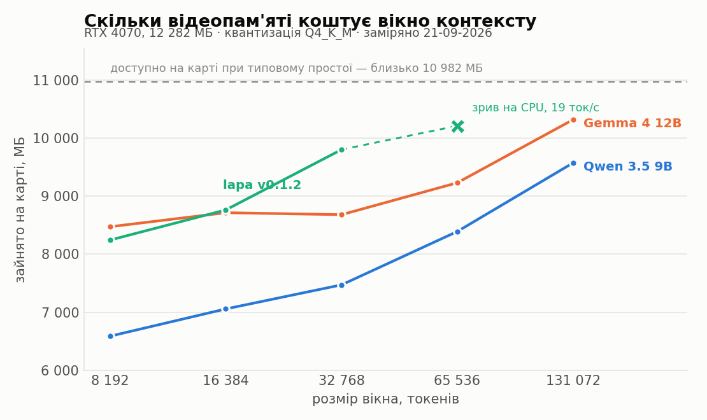
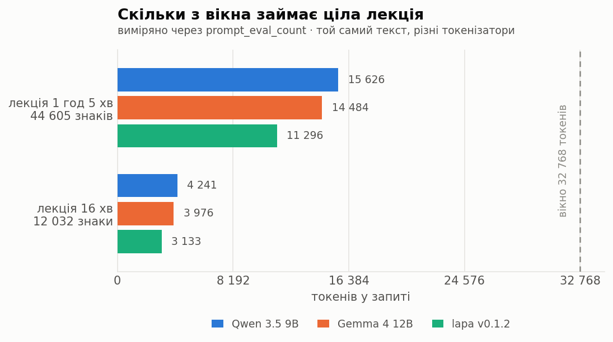

# Журнал рішень

Записи впорядковані за ходом роботи. Один запис — одне рішення.

---

## 21-09-2026. Умови вимірювань

Усі числа з цього журналу були отримані з однієї конфігурації: відеокарти NVIDIA GeForce RTX 4070 з 12 282 МБ пам'яті, драйвер 610.88, 32 ГБ DDR4 на 3200 МГц оперативної пам'яті, Windows версії 11 25H2, Ollama 0.34.2, моделі у квантизації Q4_K_M.

Зайнятість відеопам'яті у стані спокою коливається між 1264 і 2527 МБ, залежно від того, які програми у системі відкриті. І ці дані було зафіксовано завдяки тому, що кожен запуск фіксувався окремо, а не один раз на сесію. В основному пам'ять використовується nvcontainer.exe та dwm.exe, які є системними утилітами, без яких функціонування системи малоймовірне.

У панелі драйвера було вимкнено відкат у системну пам'ять (CUDA — Sysmem Fallback Policy: Prefer No Sysmem Fallback). Без цього нестача відеопам'яті не спричиняє помилки, і частина моделі мовчки переноситься в оперативну пам'ять, швидкість падає приблизно втричі, а саме вимірювання лишається зовні правдоподібним.

Таким чином, вимкнення перетворює таку ситуацію на явний збій, і саме так виявлено стелю моделі Lapa. При вікні 65 536 токенів вона показала 27% / 73% CPU/GPU і падіння з 51.6 до 19 токенів на секунду.

Звернення до Ollama виконується лише з тілом запиту, перекодованим у UTF-8 явно. PowerShell 5.1 при передачі тіла рядком замінює кирилицю знаками питання. Перевірено було прямо, модель у відповідь повідомила, що запит складається зі знаків питання. Той самий текст у рядковому режимі дав 3821 токен, у байтовому - 4241. Вимірювання, зроблені рядковим способом, до журналу не входять.

Параметри генерації для всіх моделей були виставлені однаково: temperature 0.2, top_p 0.9, top_k 40, repeat_penalty 1, seed 42, вікно 32768 токенів. Режим внутрішнього міркування було вимкнено. Однаковість тут важливіша за оптимальність, заводські налаштування у трьох моделей різні. У qwen3.5 це presence_penalty 1.5, і без вирівнювання порівнювалися б пресети, а не самі моделі.

Відтворюваність було перевірено: повтор тих самих параметрів і того самого seed дав побайтово однаковий результат на обох стенограмах.

У файлі зі знятими умовами ім'я користувача Windows у шляху замінено на `<user>`. Це єдина правка, внесена до сирих результатів вимірювань; усе інше лежить так, як його видали скрипти.

---

## 21-09-2026. Відмова від поділу стенограми на частини для записів

**Рішення.** Стенограма подається моделі одним фрагментом. Поділ на частини з подальшим складанням вилучено з інструмента.

**Підстава.** Обмеження у 8 192 токени, навколо якого будувався поділ, виставлялося вручну і не походило від моделей. Заявлене вікно становить 262 144 токени у qwen3.5 та gemma4 і 131 072 для lapa. По суті, справжню межу задає відеопам'ять, оскільки кеш уваги розміщується на карті поряд із вагами.

Виміряно приріст пам'яті на кожні 8 192 токени вікна. Це близько 136 МБ у Gemma, від 150 до 230 МБ у Qwen 3.5 і 520 МБ у lapa. Повністю на карті Gemma 4 і Qwen 3.5 утримують 131 072 токени, lapa 32 768. Довжину реального матеріалу виміряно через prompt_eval_count. Лекція тривалістю 1 година 5 хвилин 40 секунд (44 605 знаків) дає 15 626 токенів у Qwen 3.5, 14 484 у Gemma 4 і 11 296 у lapa, що становить від 35 до 48% вікна 32 768. Запас лишається і на інструкцію, і на саме формування протоколу.

Швидкість від розміру вікна майже не залежить. Gemma 4 утримує близько 50 токенів на секунду на всіх перевірених розмірах. Qwen 3.5 сповільнюється лише на 131 072. Заповнення вікна не додає витрат пам'яті. При 32 768 з порожнім запитом приріст склав 7 471 МБ, з повністю заповненим - 7 474 МБ. А отже, кеш резервується заздалегідь.

**Що це усуває.** Складання протоколу з частин було місцем, де губилися числа, дати і визначення термінів, рознесені по різних фрагментах. Ця частина інструменту не виправляється, а вилучається.

**Межі застосовуваності**. При вікні 32 768 і 1/4, залишеній під інструкції та відповідь, одним фрагментом обробляється приблизно година сорок запису для Qwen 3.5 і близько 2 годин 20 для lapa. Але варто зазначити, що для довших записів поділ доведеться повернути.

---

## 21-09-2026. Параметри генерації

**Рішення.** Для всіх моделей було виставлено один набір: temperature 0.2, top_p 0.9, top_k 40, repeat_penalty 1, presence_penalty 0, seed 42. Режим внутрішнього міркування вимкнено.

**Підстава.** Заводські налаштування у трьох моделей різні. У Qwen 3.5 це temperature 1, top_k 20, top_p 0.95 і presence_penalty 1.5, у Gemma 4 - temperature 1 і top_k 64, у lapa - top_k 64. Без вирівнювання порівнювалися б саме пресети.

Низька температура взята через те, що і протокол, і відповідь за фрагментами є видобуванням, а не творенням. Потрібне найімовірніше продовження, а не різноманітне.

Штрафи за повтор вимкнено з іншої причини. Вони карають модель саме за те, що в цих задачах зобов'язане повторюватися: імена учасників, номери подій, дати, ключові терміни. Заводські 1.5 у Qwen 3.5 - це багато.

Режим внутрішнього міркування вимкнено задля рівності умов. У Qwen 3.5 і Gemma 4 він є, у lapa його немає зовсім. Було виміряно, що коштує цей режим: з увімкненим міркуванням Qwen 3.5 витратила 649 знаків роздумів і 224 токени генерації, з вимкненим - нуль знаків і 3 токени. Відповідь в обох випадках правильна.

seed зафіксовано, щоб повтори одного прогону були порівнянними між собою.

**Межі застосовуваності.** Значення 0.2 взято з досвіду, а не з вимірювання на цьому матеріалі. Підбір температури під задачу лишається окремим експериментом.

---

## 21-09-2026. Вибір моделі для складання протоколів

**Рішення.** Для складання протоколів обрано gemma4:12b.

**Підстава.** Порівнювалися три моделі - Qwen 3.5 9B, Gemma 4 12B і lapa v0.1.2 - на двох стенограмах тривалістю 16 хвилин і 1 година 5 хвилин. На кожну стенограму припадало три завдання: складання протоколу, питання з відповіддю у тексті та питання, відповіді на яке у тексті немає.

Перевірка на відмову виявилася найпоказовішою. Gemma 4 відповіла «НЕМАЄ ДАНИХ» на обидва питання без відповіді. Qwen 3.5 відмовилася на довгій стенограмі, а на короткій назвала дату фінального екзамену - 30 вересня. Слова «екзамен» у тій стенограмі немає жодного разу, проте 30 вересня там є, це дата додаткової пари. По суті, модель узяла справжній факт і прив'язала його не до того питання, і таке спотворення небезпечніше за відверту вигадку. Lapa на довгій стенограмі склала цілу політику щодо плагіату разом із санкцією «студент отримає нуль балів», хоча слова «плагіат» у стенограмі немає.

Питання з відповіддю у тексті було обрано навмисно складне. Викладач спершу каже одне, а потім сам себе виправляє. Правильно відповіла лише lapa. Gemma 4 і Qwen 3.5 поставили на перше місце визначення з фреймворку замість того, що прозвучало у записі.

Протоколи оцінювалися читанням. Qwen 3.5 виявилася найдокладнішою. Вона відстежила самовиправлення того, хто говорить, і позначила суперечність у датах замість того, щоб мовчки її причесати. Але до розділу з цифрами вона внесла службову шапку файлу - назву моделі розпізнавання, час обробки і тривалість відео, - тобто не відрізнила технічний заголовок документа від змісту зустрічі. Крім того, у неї лишилася суперечність у балах. Lapa склала протокол утричі коротший, втратила всю систему оцінювання, зсунула дати заліку на місяць і записала до учасників слово «Вдиваюсь» - перше слово стенограми, дієслово.

Швидкість генерації: Qwen 3.5 від 63 до 67 токенів на секунду, Gemma 4 близько 47, lapa близько 46. Пік відеопам'яті: 8 752 МБ, 9 972 МБ і 11 086 МБ відповідно.

**Що відхилено і чому.** Lapa вибула, хоча саме вона була новим кандидатом. Її перевагою мала бути якість української, і на протоколі ця перевага не підтвердилася. Обіцяна економія токенів виявилася не півторакратною, а від 28 до 38 відсотків, і на цьому масштабі вона не дає нічого: година лекції і так займає менше половини вікна в усіх трьох моделей. Qwen 3.5 лишається швидшою майже в півтора раза і придатною там, де важлива швидкість, а не точність.

**Межі застосовуваності.** Одна стенограма кожного типу, один seed, оцінювання читанням. Відтворюваність перевірено окремо.

---

## 21-09-2026. Перевірка висновків і спростована гіпотеза

**Відтворюваність.** Повтор за тих самих параметрів і того самого seed дав побайтово однаковий результат на обох стенограмах. Отже, різниця між моделями, зафіксована вище, є справжньою, а не шумом прогону.

**Спростована гіпотеза.** Припущення, що вигадані українські слова у вересневих прогонах спричинені температурою 1, не підтвердилося. При температурі 1 Gemma 4 не вигадала жодного слова. Усі підозрілі словоформи - ТАЄБ, DOE-UA, класрум - було перевірено за стенограмою і знайдено в ній. Причина вересневої проблеми лишається невстановленою, і наступним підозрюваним є штраф за повтор: він відштовхує модель від уже вжитого слова до найближчого схожого, що за формою збігається зі спостереженим спотворенням.

**Що температура таки псує.** Не словник, а числа. При температурі 1 один прогін із двох видав «максимум 80 балів за всі лаби, оскільки 6 та 7 не обов'язкові». Це неправильно арифметично, адже сім лабораторних по десять балів дають сімдесят, і суперечить саме собі всередині одного речення. Три прогони при температурі 0.2 дали 70.

**Нестабільність чисел незалежно від температури.** З 18 числових фактів довгого протоколу лише 10 присутні в усіх чотирьох прогонах. Частина розбіжностей пояснюється різним формулюванням одного й того самого, проте випадок із сімдесятьма і вісімдесятьма балами показує, що справа не лише у формулюваннях. Звідси випливає, що одного проходу недостатньо для збирання всіх чисел, і розділ «Правила і цифри» потребує окремого рішення.

**Відхилені метрики.** Дві автоматичні метрики було забраковано після першого ж застосування. Словникова перевірка на неіснуючі словоформи помічає лише власні назви та запозичення - прізвища тих, хто говорив, код навчальної групи, telegram-чат, breakout-румах, - і жодної справжньої вигадки не знайшла. Друга метрика, частка слів, лемм яких немає у стенограмі, виявилася шкідливою: за нею найкращий результат показала lapa саме тому, що написала найкоротший і найнеповніший протокол. Але варто зазначити, що для дипломної частини, де питань будуть сотні, оцінювання читанням неможливе, і метрики доведеться робити заново й уважніше.

---

## 22-09-2026. Штраф за повтор: механізм підтверджено, вигадування ні

**Рішення.** repeat_penalty лишається на одиниці, тобто вимкненим.

**Підстава.** Шість прогонів Gemma 4 на двох стенограмах зі значеннями штрафу 1, 1.1 (заводське) і 1.3. Решта параметрів і seed зафіксовані, отже будь-яка різниця йде тільки від штрафу. Прогін із вимкненим штрафом дав ті самі 522 і 938 токенів, що й два попередні заміри, - детермінізм тримається.

Механізм підтвердився. Ключові терміни стенограми у протоколі повторюються тим рідше, чим вищий штраф: на годинній лекції сумарно 24 рази при вимкненому, 17 при заводському і 16 при 1.3. Слово «лабораторний» просідає вдвічі, з десяти до п'яти. Видно й заміну. При вимкненому штрафі модель пише однаково - «лабораторних робіт», «лабораторної роботи». При 1.1 вона вводить скорочення «(лаб)» і далі обходиться словом «роботи».

Ціна цього виміряна і вона у фактах. При вимкненому штрафі розділ «Правила і цифри» містить рядки «Перездачі: з 23 по 28 червня» і «Відсотки: 15-20% (падіння акцій після виходу китайського стартапу)». При заводському 1.1 обох рядків немає взагалі. Два справжні факти зникли з розділу, який існує саме заради того, щоб числа не губилися.

**Чого не сталося.** Вигаданих слів немає при жодному значенні штрафу. Усе, що словникова перевірка позначила як нове, виявилося словоформами вже присутніх слів, прогалинами самого словника і одним хибним спрацюванням: «необов'язкові» позначено через типографський апостроф, якого морфологічний аналізатор не розпізнає.

**Вересневий випадок.** Гіпотеза про штраф за повтор була другою після гіпотези про температуру, і обидві спростовані власним заміром. Випадок закривається не як пояснений, а як невідтворюваний: він виник у схемі з поділом стенограми на частини та наступним складанням, а цієї схеми більше немає. Умови його виникнення усунені разом із нею.

**Межі застосовуваності.** Одна модель, дві стенограми, один seed, три значення штрафу.

---

## 23-09-2026. Кандидати на розпізнавання мови та метод еталона

**З чого все почалося?** Для початку було взято моделі Large V3 і Turbo для порівняння, і було виявлено, що не можна порівнювати розшифровки двох моделей від одного постачальника між собою і вважати, що збіг між ними (91.5 %) показує, яка з них більш коректно розпізнала мову. Це, по суті, однакові моделі, лише з різницею в тому, що Turbo швидший і навчений на тих самих даних, що і Large V3, тому спільні помилки рахувалися як збіг. Через що було прийнято рішення допрацювати метод порівняння моделей, взявши трьох кандидатів, для кожного своя роль. Large V3 була взята як база, Turbo як варіант, який все ще є дієздатним, і Parakeet TDT 0.6B v3 як модель іншої архітектури, що має забезпечити відсутність генерації тексту під час тиші, на відміну від декодера Whisper, який може сприйняти тишу як якісь слова. Він був взятий для того, щоб була модель, яка ніяк не корелює з Whisper. Також були відсіяні моделі w2v-bert, тому що вона не дає пунктуації і регістрів, а також Canary 1B, тому що вона потребує 6 ГБ відеопам'яті замість 2, а окремих результатів для української мови не опубліковано, лише середнє по 25 мовах.

**Еталон.** Головним випробуванням на цьому етапі було утворення еталону без ручної розшифровки всього тексту. Було взято чотири голоси, а саме три моделі плюс Gemini по аудіо. Розшифровки вирівнюються, і слухаються лише ті місця, де голоса розійшлись. Gemini тут виступив у ролі голосу, а не судді, тому що він все ще не є істиною, і ми, по суті, обрали б модель, яка найбільш схожа на Gemini, замість того, щоб брати її просто як ще один голос. Еталон складається зі слів, у яких зійшлися всі чотири голоси, більшості три проти одного і ручного прослуховування решти.

**Слабкість цього методу** заключається у тому, що є ризик того, що буде покарана модель, яка коректно розпізнала текст, коли три інші моделі помилилися однаково, адже більшість три проти одного приймалася без прослуховування. Щоб зрівняти шанси, у будь-якій трійці є голос не-Whisper, тож одне сімейство саме більшість не збере. Якщо ж помилилися всі чотири, помилка потрапляє в еталон, і WER занижений в усіх однаково.

**Обмеженість матеріалу.** Одна консультація, 16 хвилин, тема управління проєктами, а не кібербезпека, через що термінологія влаштована з англіцизмів, і для розпізнавання це важкий випадок. Тому вибірка непогана. Але переносити це на криптографічну термінологію не можна. Числових токенів 9, тому числову точність цей запис не перевіряє.

**Умови.** Та сама RTX 4070, faster-whisper 1.2.1, ctranslate2 4.8.2, onnx-asr 0.12.0, onnxruntime-gpu 1.24.4.

---

## 23-09-2026. Постійність термінів

**Навіщо потрібна друга метрика?** WER штрафує за помилку в «ну» так само, як і за помилку у якомусь терміні. А в цій оцінці таке оцінювання не є справедливим. Якщо термін записаний по-різному, RAG рознесе «IDS» та «ай-ді-ес» по різних чанках і ніяк їх не зв'яже. Таким чином воно поламає структуру, а не лише додасть одне зайве слово. Тому міряється окремо, скількома способами модель записала один і той самий термін.

**Механізм, заради якого потрібна ця метрика.** Помилку, яка повторюється однаково, можна виправити словником замін після розпізнавання, але випадкову помилку виправити не можна. Кожен раз отримуємо нове слово, і в словник його ніяк не впишеш. Тому важлива не тільки кількість варіантів, а й які саме це варіанти. Найважливіша властивість — це те, що еталон не потрібен. Метрика рахується прямо по виходах моделей, тому порахували її першою.

**Числа.** 18 термінів, зайві написання понад одне на термін, сума по всіх термінах:

| large-v3 | turbo | Parakeet | Gemini |
|---|---|---|---|
| 6 | 7 | 13 | 4 |

**Які помилки у кожної моделі?** Parakeet кожен раз інтерпретує слово по-новому. Ця помилка не лікується словником, тому розрив з іншими вагоміший, ніж саме число. Large-v3 змішує алфавіти, через що утворюється проблема, про яку говорив раніше, з RAG. І це видно без усякого еталону, тому що слова і терміни звучать однаково, але пишуться іншими літерами. Turbo стабільно пише кирилицею, але бувають випадки, коли один термін має чотири різних варіанти.

**Висновок.** Large і turbo метрика не розрізнила. Parakeet виділяється у найгіршу сторону.

**Обмеження експерименту.** Лише один запис. У 12 з 18 термінів усього від одного до трьох вживань, а сім термінів не дали розбіжностей у жодної моделі, тобто метрика тримається на одинадцяти. Корені для пошуку підбирались за тими ж текстами, що і рахувались потім. Метрика замкнута сама на себе.

**Спростований підхід.** Спершу кандидати в терміни шукались евристикою: латиниця, дефіс, апостроф, закінчення запозичень. Потім 86 знайдених груп розмічались вручну. Це не спрацювало. Двослівні терміни рвались, і «екшен» та «айтем» потрапляли в різні групи. Кириличні запозичення без особливих ознак не ловились взагалі, наприклад «спринт» і «демо». І на 86 групах ручна розмітка неминуче помиляється. Тому підхід замінили на зворотний: спершу термін, потім його корені, і перевірка знайденого очима.

**Наслідок, який веде до запису 3.** Словник замін для кожної дисципліни свій, і випадкові зміни у нього ніколи не запишеш. Тому ціль задали правилом, а не списком: англійські запозичення пишуться латиницею, а не кирилицею. Правило не залежить від предметної області. Перша спроба застосувати його через підказку Whisper була невдала, про це запис 3.

**Про імена.** До журналу увійшли лише форми термінів, контексти вживання з транскрипцій сюди не потрапили.

**Умови.** Large-v3 і turbo з відкатом температури та VAD, Parakeet із налаштуваннями за замовчуванням, Gemini по аудіо.

---

## 23-09-2026. Декодування: дві спростовані гіпотези і знахідка

Тут дві історії. Перевірялася гіпотеза, а по дорозі знайшлося те, що виявилося гіршим за неї.

**Гіпотеза.** Правило «англійські запозичення пишуться латиницею» застосує сам Whisper. У `initial_prompt` було дано нейтральну фразу, де латиниця й кирилиця перемішані, без жодного предметного слова. Розрахунок був на те, що декодер продовжує манеру того тексту, який бачить перед собою.

**Спростовано, і механізм тут головне.** Whisper розпізнає вікнами по 30 секунд. Підказкою для кожного наступного вікна слугують останні 223 токени того, що він уже написав сам, і саме це вмикає параметр `condition_on_previous_text`. Наша фраза стоїть у цій стрічці лише на самому початку, і приблизно за хвилину її повністю витісняє власний кириличний текст моделі. Це можна було прочитати у вихідниках ще до прогону, і саме цього зроблено не було.

**Друга спроба, `hotwords`.** Ця фраза вставляється в кожне вікно заново, тобто витіснити її нічим. У turbo латиниці справді стало більше, рядків із нею 3 проти 10, але вперемішку з кирилицею, і розбіжність написань зросла з 6 до 7, тобто не покращилася. У прийнятій конфігурації, з відкатом і VAD, результат розійшовся в різні боки: у large-v3 розбіжність 6 проти 7, у turbo 7 проти 5. На одному файлі це коливання в межах двох написань, надійного покращення немає. Непідтверджене припущення про механізм: одна коротка фраза програє 223 токенам власної кириличної історії.

**Висновок.** Правило лишається, але застосовуватиме його не Whisper, а gemma4 на етапі складання протоколу.

**Що знайшлося по дорозі, і це важливіше за саму гіпотезу.** large-v3 із будь-якою підказкою зривався в петлю. З `initial_prompt` це «Дякую.» 679 разів поспіль, із `hotwords` — 685 разів, і в обох випадках починаючи з тієї самої позначки 90.7 секунди. Замість 2026 слів у розшифровці лишалося 813, тобто мовчки губилося 14.5 хвилини лекції з 16. Жодної помилки при цьому не виникало, і вивід виглядав як звичайний текст.

**Причина — успадкована з попереднього заходу `temperature=0.0` без відкату.** У Whisper є штатний захист від цього. Якщо вікно вийшло підозрілим, тобто текст у ньому надто добре стискається (а це ознака повтору) або модель у ньому надто невпевнена, вікно розпізнається заново при підвищеній температурі. Коли задано саме 0.0 без списку відкату, цей захист вимкнено повністю. Петля при цьому ще й підживлює сама себе тим самим механізмом, який витіснив підказку: наступне вікно бачить у стрічці «Дякую. Дякую. Дякую.» і сумлінно продовжує в тій самій манері.

Варто зазначити, що прогін без підказки на тих самих налаштуваннях уцілів. Але це везіння, а не властивість конфігурації, адже захист був вимкнений і там.

**Друга хвороба — тиша.** З підказкою і без VAD на паузах дописується те, чого не було: у turbo з `initial_prompt` це «Дякую за перегляд!» десять разів, із `hotwords` — «Побачимось за два тижні.» п'ять разів. Це слід навчання на субтитрах YouTube. Без підказки цього не траплялося, у large-v3 теж. Друга фраза пережила відкат температури і зникла лише з VAD, тобто відкат від цього не лікує, VAD потрібен сам по собі.

**Прийнята конфігурація.** Відкат температури 0.0…1.0, Silero VAD, який вирізає тишу ще до розпізнавання, і зафіксоване зерно CTranslate2.

**Що перевірено.**

Без підказки відкат у large-v3 не спрацював жодного разу, текст вийшов байт у байт таким самим, як без нього. Тобто у нормальному випадку захист не коштує нічого.

Під навантаженням, тобто з тією самою підказкою, яка ламала, немає ні петель, ні вигадок на тиші.

Повторний прогін дає побайтово той самий текст в обох моделей. Відкат обирає слова випадково, але зерно цю випадковість фіксує, тож відтворюваність, перевірена раніше, збереглася.

Ціна — VAD додає 6.4 секунди у large-v3 (85.7 проти 92.1) і 7.3 секунди у turbo (21.7 проти 29.0) на шістнадцяти хвилинах запису.

Розбіжність термінів на прийнятій конфігурації становить 6 у large-v3 і 7 у turbo. Саме ці числа й наведено в попередньому записі.

**Побічне спостереження.** turbo без підказки взагалі не розставляє пунктуацію і регістр, вони з'являються з `initial_prompt`. Для складання протоколу це суттєво, і при використанні turbo це доведеться враховувати окремо.

**Умови.** Числа лежать у `results/asr_decoding_2026-09-23.csv`.

---

## 23-09-2026. Еталон, WER і рішення

**Перше спростоване припущення.** За планом очікувалося, що чотири голоси зійдуться приблизно у 90 % позицій. Насправді ж розходяться 25.6 %, тобто 498 позицій із 1942, і прослухати всі розбіжності означало б прослухати майже всю лекцію.

**Вихід із цього такий.** Більшість 3:1, а це 316 позицій, приймається без прослуховування, і це саме та слабкість методу, яку описано в першому записі. Слухалися лише позиції 2:2 і ті, де всі чотири голоси різні: 182 позиції, тобто 9.4 %, зібрані у 107 ділянок, приблизно вісім хвилин звуку.

Скільки разів кожна модель лишалася сама проти трьох: large 34, turbo 67, Gemini 75, Parakeet 140. Варто зазначити, що це не показник точності, адже одинак цілком може виявитися й правим.

**Як зібрано еталон.** Слова, у яких зійшлися всі чотири голоси, плюс більшість 3:1, плюс рішення на слух на спірних ділянках. До цього додалося ще два рішення. Сім ділянок, а це 26 позицій, виключено однаково в усіх голосів: там або говорять одночасно, або відповіді немає взагалі. І кожен термін зведено до однієї мітки, тому що розбіжність написань уже міряно окремо у другому записі; без такого зведення вигравала б та модель, чиє написання випадково збіглося з написанням людини.

**Нормалізація.** Терміни зводяться до мітки, дефіс замінюється пробілом, однозначні заповнювачі та безпосередні повтори прибираються. Робиться це однаково і для еталона, і для всіх чотирьох голосів.

**Результат.**

| голос | WER | заміни | пропуски | вставки |
|---|---|---|---|---|
| large-v3 | 13.6 % | 81 | 29 | 138 |
| turbo | 15.3 % | 108 | 31 | 140 |
| Parakeet | 21.2 % | 153 | 31 | 201 |
| Gemini (не кандидат) | 13.0 % | 75 | 42 | 119 |

Довжина еталона — 1819 слів.

**Дві властивості цього еталона, які треба назвати вголос.**

Вставок учетверо-вп'ятеро більше за пропуски, і так в усіх чотирьох голосів без винятку. Це означає, що еталон систематично коротший за будь-яку з розшифровок, і кожна модель отримує покарання за слова, яких в еталоні просто немає. Через що абсолютні числа завищені й порівнювати їх із опублікованими бенчмарками не можна. Порівняння моделей між собою при цьому лишається чинним, тому що зсув спільний для всіх.

Опорою вирівнювання слугує large-v3, тобто саме його послідовність слів є кістяком, на який накладаються більшість і рішення на слух. Це структурна перевага на його користь, і її треба тримати в голові. Але вона ж робить головний висновок міцнішим: навіть маючи цю перевагу, large-v3 не показав значущого відриву від turbo.

**Значущість — головний механізм цього запису.** Різниця 13.6 проти 15.3 сама по собі ще нічого не означає, доки невідомо, наскільки вона стійка. Перевірялася вона бутстрапом: текст багато разів перезбирався з випадково вибраних шматків, і щоразу WER рахувався наново, десять тисяч перезбирань.

Перезбирали блоками по 40 позицій, а таких блоків 48, а не окремими словами. Причина у тому, що помилки сусідніх слів пов'язані між собою: одна нерозбірлива фраза дає одразу кілька помилок поспіль. Якщо ж перемішувати окремі слова, цей зв'язок рветься, розкид занижується, і слабка різниця починає виглядати значущою.

**Що вийшло.** Parakeet гірший за обох значущо: на 5…11 відсоткових пунктів гірший за large і на 4…9 за turbo. Разом із розбіжністю написань, де у нього 13 проти 6 і 7, він вибуває.

large проти turbo не розрізняються. Різниця 1.7 пункта, 95 % довірчий інтервал від −1.0 до +4.0. Нуль лежить усередині інтервалу, отже знак різниці може виявитися будь-яким. large кращий у 89.6 % перезбирань, а для значущості потрібно 97.5 %.

**Друге спростування: сліпа хвилина не спрацювала.** Її задумували для того, щоб знайти помилки, які проґавили всі чотири голоси. Сліпа розшифровка перших півтори хвилини розійшлася з еталоном на 23.9 % при 134 словах, але це переважно її власні розбіжності: подекуди замість дослівного тексту вийшов переказ. На позначці 1:15 два прослуховування однієї людини розійшлися між собою, «було добре» у відповіді проти «пройшло добре» наосліп. Звідси випливає, що шум самого еталона приблизно такого ж розміру, як і різниця між large і turbo. Відділити спільні промахи всіх чотирьох у такий спосіб не вдалося.

**Третє спростування.** У плані стверджувалося, що «ретро-перспективи» вимовити не можна, а отже це помилка моделі. Прослуховування на позначці 6:01 показало, що саме так і було сказано. Спотворені форми Parakeet це не виправдовує, вони лишаються помилками.

**Рішення.** За точністю large і turbo не розрізняються, тому обирали за призначенням.

| | large-v3 | turbo |
|---|---|---|
| знаків пунктуації | 757 | 92 |
| час на 16 хвилин | 92 с | 29 с |
| відеопам'ять | ~3.3 ГБ | ~2 ГБ |

Відеопам'ять тут є спостереженням під час прогону, а не заміром, тому що під WDDM витрати за процесами не видно.

large-v3 береться для розшифровки після лекції: час там неважливий, а пунктуація потрібна протоколу. turbo береться для живої розшифровки: він швидший і менше займає на карті поряд із gemma4. Обидві моделі працюють у конфігурації з відкатом температури, VAD і зафіксованим зерном.

**Застереження, яке веде до наступного етапу.** turbo міряли офлайн, цілим файлом. У живому режимі звук приходить шматками, і контексту в декодера менше. Перш ніж будувати на ньому службу, це потрібно перевірити окремо.

**Умови.** Числа лежать у `results/asr_wer_2026-09-23.csv`.
